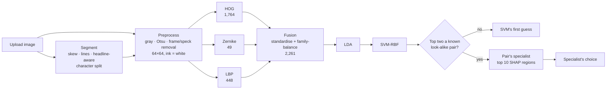

# Handwritten Modi Character Recognition using Handcrafted Features

**Modi Lipi XAI** (the code and web app in this repository) recognises handwritten Modi characters with
one SVM on handcrafted features (HOG, Zernike moments, LBP). When the SVM's top two guesses are a known
look-alike pair, a small specialist for that pair makes the final call, using only the regions of the
character that SHAP says separate those two.

**Result:** 57 characters, public MODI-HChar dataset, fixed test set of 11,400 images: SVM alone
**86.36%**, with 12 specialists **86.78%** (182 images fixed, 134 broken, McNemar p = 0.008). Nine pairs
improve and three get worse. See [Results](#results).

### Quick start

```bash
python -m venv .venv
```

```bash
.venv\Scripts\activate
```

```bash
pip install -r requirements.txt
```

```bash
python scripts/download_data.py
```

```bash
python scripts/run_preprocessing.py
```

```bash
python scripts/run_feature_extraction.py
```

```bash
python scripts/run_lookalike.py
```

```bash
python -m web.server
```

### Architecture



Tests: `python -m pytest -q` (17 fast unit tests + a headless end-to-end app test).

## What is Modi script?

Modi (मोडी) is a cursive script that was used to write Marathi for about 700 years. It appears in
land records, court documents and administrative letters across Maharashtra. Very few people can
read it today, so millions of archived documents are effectively locked away.

## Objectives

1. Recognise 57 handwritten Modi characters with one model, an SVM on handcrafted features.
2. Find which pairs the SVM mixes up most, and use SHAP to see which parts of the character separate each pair.
3. Build a small specialist for each look-alike pair that looks only at those parts, and let it decide when the SVM's top two guesses are that pair. This is the new idea in the project.
4. Check on a fixed test set whether the specialists really reduce mistakes, pair by pair, including the pairs that get worse.

[docs/02_synopsis/Objectives_and_Implementation.md](docs/02_synopsis/Objectives_and_Implementation.md) lists where each objective sits in the code.

## Experimental design

- **Classes:** all classes found on disk (the uploader describes 57: 10 digits, 12 vowels,
  35 consonants). Nothing is hard-coded; see `results/metrics/dataset_summary.json`.
- **One seeded ordering per class.** Each class's files are shuffled with an RNG derived from the
  global seed (42) and a stable hash of the class label. Every subset below is a prefix of that
  ordering, so it is a genuine random sample, identical across runs and machines, and unaffected by
  other classes.
- **Fixed held-out test set:** the first 200 images of every class (see the short-class policy
  below). The same test set is used for every experiment, every curve point and both model families.
- **Training set:** 500 images per class, taken from the images after the test block. Choosing the
  pairs, the regions and which specialists to keep uses 3-fold out-of-fold predictions on this set only.
- **Per-category reporting:** every metric is also broken down into digits / vowels / consonants.
- Only the 2,200-per-class pool these experiments need (200 test + 2,000 train) is preprocessed by
  default. `--max-per-class 0` processes everything.

### Short-class policy (never fails quietly)

- **Test size is decided once per class**, from its image count *N*, so the test set never changes
  between curve points. If *N* ≥ 200 + 72 = 272, the class gets 200 test images. Otherwise its test
  set is **scaled** to ⌊0.2·N⌋ (minimum 1), matching an 80/20 split.
- **A class with fewer training images than a curve point stays in that point** with every training
  image it has. The class set is therefore identical at every point. The point is marked
  **incomplete** (hollow marker on the headline chart), and accuracy is *additionally* reported on
  the complete classes only, so any distortion is visible.
- Every short class is logged in a warning banner and recorded in `dataset_summary.json`
  (`split_plan_full_dataset` and `preprocessing.split_plan_processed_pool`) and in every curve-point
  result.
- Known boundary effect: just below 272 images, a scaled class can end up with *more* training images
  than a class just above it (e.g. 271 gives 54 test / 217 train, while 272 gives 200 test / 72 train).
  This only matters if such classes exist, so it is **measured, not assumed**. Every run reports how
  many classes have 150–400 images (`boundary_band` in the split plan). If any do, the rule switches
  to the smooth `test = min(200, max(20, int(0.2 * n)))`, which has no cliff. If none do, the rule
  stays and this note documents why.

## Setup (Python 3.11+, tested on 3.14, CPU only)

```bash
python -m venv .venv
```

```bash
.venv\Scripts\activate
```

```bash
pip install -r requirements.txt
```

Then check that every library *actually works* on your Python (this trains a tiny model, runs SHAP,
HOG, LBP, Zernike, OpenCV and XGBoost on dummy data, and prints PASS/FAIL per library):

```bash
python scripts/check_environment.py
```

**PyTorch is not used by the main model or the app.** It is only needed for the earlier reference
CNN experiment (`src/baselines/`, `scripts/run_cnn_baseline.py`). The pipeline, the models and the web
app never import it. On Windows the pinned PyPI wheel is CPU-only. On Linux, install the CPU build
first to avoid a multi-GB CUDA download: `pip install torch==2.14.1 --index-url https://download.pytorch.org/whl/cpu`.

### Kaggle credentials (needed once, for the download)

The `kaggle` package (v2.x) accepts any **one** of the following. They are checked in this order:

| Method | How |
|---|---|
| New-style API token | env var `KAGGLE_API_TOKEN`, or the token text saved to `~/.kaggle/access_token` |
| Legacy API key | `~/.kaggle/kaggle.json` containing `{"username": "...", "key": "..."}`, or env vars `KAGGLE_USERNAME` + `KAGGLE_KEY` |
| OAuth | run `kaggle auth login` once (cached in `~/.kaggle/credentials.json`) |

Create a key at <https://www.kaggle.com/settings/api>. On Windows, `~` is `C:\Users\<you>`.
`KAGGLE_CONFIG_DIR` moves only `kaggle.json`. None of these files may be committed, and all of them
are in `.gitignore`.

No credentials? Download the zip in your browser from the
[dataset page](https://www.kaggle.com/datasets/msd6013/modi-hdc-historical-handwritten-modi-script)
and run `python scripts/download_data.py --from-zip "C:\path\to\archive.zip"`.

## Dataset: MODI-HDC (measured numbers)

The Kaggle bundle is **~10 GB** and holds two datasets:

- **MODI-HChar**: isolated handwritten characters in `category/class/image` folders.
- **MODI-HHDoc**: full handwritten document pages. Only a 20-page sample is extracted, for testing
  segmentation.

What the loader actually counted on disk (`results/metrics/dataset_summary.json`):

| | Measured | Uploader's claim | Surveyed papers' benchmark |
|---|---|---|---|
| Classes | **57** (10 digits, 12 vowels, 35 consonants) | 57 | 46 |
| Images | **575,912** | 575,920 (8 fewer found) | 46 × 90 = 4,140 |
| Images per class | **10,098 – 10,110** (max/min = 1.001) | ~10,100 | 90 |
| Image format | 170×170 RGB JPEG | | |
| Files skipped | 20 (15 hidden/system, 5 `.psd`) | | |

Note the class-count inconsistency: the papers say 46, this dataset has 57, and its 12 vowels +
35 consonants make 47 letters. The 35 consonants include the conjuncts क्ष, ज्ञ, त्र, श्र and omit
ङ, ञ, ष. `results/figures/class_reference_sheet.png` shows three real examples of every class.
**Labels and Devanagari.** The model predicts the dataset's romanised folder names. For display, 47 of them map directly to Devanagari. The 10 dental/retroflex classes (`ta`, `th`, `tha`, `thh`, `thha`, `d`, `dh`, `dha`, `n`, `nn`) cannot be mapped from their names, so they were **matched by shape to the official Unicode Modi code chart** (Pandey 2011, Fig. 1): `ta`=त, `th`=ट, `thh`=ठ, `tha`=थ, `thha`=द, `d`=ड, `dh`=ढ, `dha`=ध, `n`=न, `nn`=ण (`results/figures/label_verification_sheet.png`, made by `scripts/make_label_verification_sheet.py`). The matching is one-to-one, and it explains the second most-confused pair: in Modi, द (`thha`) and ह (`h`) are drawn almost identically. All mappings stay marked `verified: false` in `src/labels.json` until a Modi reader confirms them.

## Preprocessing (stage 1)

- **Polarity:** every processed image is uint8 with **ink = 255 (white) on background = 0 (black)**.
  Ink is the minority side of the Otsu threshold. The image border is used only as a tie-break,
  because many scans carry a faint frame around the edge that fooled a border-first rule.
- **Blank images are rejected:** 16 images in the pool contain no glyph at all.
- **Scan-frame removal:** about **10%** of dataset images carry a fragment of the scanning frame
  along an edge. Left in, it shrinks and off-centres the glyph. The outer 2% is blanked, and
  elongated components lying entirely within 7% of an edge are removed. Headlines are attached to
  the glyph, so they survive.
- Grayscale → median blur → blank check → Otsu → frame removal → speck removal (dots and matras
  survive) → crop to ink → pad to square → area-resize to 64×64 → re-binarise.
- **Deskew is off by default.** On an isolated character, moment-based slant cannot be told apart
  from the glyph's own diagonal strokes, and in testing it sheared upright glyphs. Page and line skew
  are corrected in segmentation instead.
- **Interior scan-grid lines:** about 3% of images also contain a thin *vertical* grid line inside the
  image, usually on the right and sometimes dashed. A thin, separate vertical piece is removed only
  if its column covers at least 75% of the image height **and** extends beyond the character's body.
  Grid lines run the full cell height, while real detached strokes (as in `ai` and `am`) stay within
  the glyph. Isolated *horizontal* lines are never removed: measured on the data, they are mostly
  genuine headlines, for example over Modi digits. On 8,550 checked images the rule changed 2.7%,
  spread over 39 classes (at most 6.6% in any one) and no digits. App crops skip this step, because
  segmentation already crops tightly around the glyph.
- The default pool is **2,230 images per class** (200 test + 2,000 largest training size + 30
  reserve): 127,110 selected, **127,087 processed**, 23 rejected as blank or inkless.

## Features (stage 3)

| Family | What it captures | Dimensions | Extraction time |
|---|---|---|---|
| HOG (8×8 cells, 2×2 blocks, 9 orientations, light blur first) | stroke direction and layout | 1,764 | 0.47 ms / image |
| Zernike moments (degree 12, disc = whole image) | rotation-invariant global shape | 49 | 0.36 ms / image |
| LBP (uniform, two scales: P=8/R=1 and P=16/R=2, 4×4 grid) | stroke ends, corners, junctions | 448 | 0.59 ms / image |
| **Fused** | all three | **2,261** | |

Measured on a real glyph, a 10° rotation changes the Zernike vector by **3.5%** and the HOG vector
by **79%**. That complementarity is the reason for fusing them.

**Family-balanced fusion (novelty).** After standardising, each family is scaled by 1/√(its size),
so HOG's 1,764 values cannot outvote Zernike's 49 in PCA or in the RBF kernel. The ablation compares
this with plain concatenation.

## Models (stage 5)

Every pipeline is: standardise → family-balance → LDA → SVM (RBF, C = 10).

LDA over PCA and the SVM over Random Forest were both chosen on training data, with 3-fold
cross-validation (`run_training.py --only select`): LDA 84.5% vs PCA 79.7%, SVM 85.5% vs RF 83.4%.
Random Forest, XGBoost and a stack of all three were also tried, and all came in below the SVM.

**Look-alike specialists (`src/lookalike.py`, `scripts/run_lookalike.py`):**

1. Out-of-fold SVM guesses on the training set give the 15 most confused pairs.
2. For each pair, Kernel SHAP (30 images, 150 samples each) on a binary SVM ranks the 35 feature groups.
3. A specialist is an RBF SVM (C = 1, balanced) on that pair's training images, using only the columns of its top 10 groups.
4. A specialist is kept only if it beats the SVM on held-out training images. 12 of 15 were kept.
5. At prediction time, if the SVM's top two (by decision score) are a kept pair, the specialist decides.

## Segmentation (stage 2)

Lines come from the horizontal projection profile, after a projection-profile skew search
(±12°). Characters come from blank columns of the full image, including the headline, so a character
whose parts touch only through its own headline stays whole. Over-wide segments are split after
removing the headline (shirorekha) *inside* that segment, or else at the deepest column valley.
Fragments narrower or lighter than a typical character (detached strokes, dots, headline tails)
are merged into the nearer neighbour, but never into an over-wide box. Every box carries flags
(`wide`, `narrow`, `tall`, `connected`) and a confidence, and the app explains them in plain
language.

**Recognition-guided segmentation (novelty, `src/resegment.py`).** Touching characters leave no
blank column, so blank-column splitting alone leaves several of them in one over-wide box. For every
box flagged `wide` or `connected`, candidate cuts are placed at the valleys of the ink profile,
ignoring the headline. Every way of cutting the box is then scored by the **trained classifier's
confidence in each piece**, plus a weak prior on character width, and dynamic programming keeps the
best-scoring split. The unsplit box is always one of the options, so a genuinely wide character is
not forced apart. Pieces produced this way are flagged `resegmented`. It is evaluated on synthetic
words with known answers by `python scripts/eval_segmentation.py`
(`results/metrics/segmentation_eval.json`, examples in `results/figures/segmentation_examples.png`).

The test words are built from **test-split** images: 120 words of 3–5 letters, either separated or pushed
together until the strokes touch, under a joining headline. Its settings (a per-character cost of 0, and
splitting only boxes wider than 1.8× the typical width) were tuned on separate words built from
**training** images. It runs only on lines where projection segmentation flagged a problem, because
re-reading clean lines slightly hurt.

| Synthetic test words | Count correct | Character error rate | Whole word correct |
|---|---|---|---|
| Separated, projection only | 88.3% | 20.5% | 45.0% |
| Separated, + recognition-guided | 88.3% | 20.3% | 45.0% |
| Touching, projection only | 5.8% | 81.8% | 0.8% |
| Touching, + recognition-guided | **41.7%** | **64.1%** | **10.0%** |

Two other segmentation fixes came from this evaluation. Many single Modi characters are up to 2.5×
wider than they are tall, so the "too wide, must be joined" rules now allow that. Detached
headline tails and strokes are merged back. Touching characters remain hard: only 10% of touching
words are read completely correctly, and real manuscripts (ligatures, slant, faded ink) are harder
still.

Tested on the bundled samples, which are composed from **test-split** glyphs with known answers:
**5/5, 8/8 and 6/6 characters found.** On a crop of a real manuscript page, the writing is
continuous cursive and the result is correctly reported as unreliable. **Segmenting real
connected Modi writing is not solved here; the app says so instead of hiding it.**

## Explainability (stage 7)

Raw SHAP over 2,261 features would be unreadable and slow, so the features are grouped into **35
meaningful units**: HOG and LBP evidence in each cell of a 4×4 image grid (16 + 16), and Zernike
coarse / medium / fine shape (3). **Kernel SHAP** then explains the *SVM's* probability
for a class against an "average character" baseline (the mean training feature vector). Two checks
run on every global computation:

- **Additivity:** the baseline plus the contributions must equal the model output.
- **Faithfulness (deletion test):** hiding the top-ranked groups must lower the probability more
  than hiding random groups.

Only the baseline vector is cached (`results/shap/baseline.npy`); the explainer is built around the already-loaded model in milliseconds.

## Web app

```bash
python -m web.server
```

Then open http://127.0.0.1:8000. To use it from a phone on the same Wi-Fi, run
`python -m web.server --host 0.0.0.0` and open the laptop's IP address on port 8000.

A small multi-page site (Starlette, plain HTML/CSS/JS, no front-end framework) designed for phones
first, with a cut-paper look and a bottom tab bar. All numbers on it are read from `results/`, so
it updates itself when experiments finish.

- **Home:** key results as swipeable cards, the status of each objective and the new idea.
- **Read:** upload or photograph a page, pick a bundled sample, or write a character on the drawing
  pad. Shows numbered boxes coloured by confidence, the assembled reading and one row per character.
  Tapping a character opens its top guesses, says whether a specialist made the final call, and offers
  a SHAP explanation. Results download as CSV or JSON.
- **Results:** the specialists pair by pair, the SVM by character type, the pairs still mixed up most,
  the word segmentation evaluation, and published results for context.
- **Explain:** where the SHAP evidence comes from (by descriptor and by region), contrastive SHAP
  for look-alike pairs, and the faithfulness (deletion) test.
- **Script:** all 57 characters with a real dataset sample, test-set F1, and what each one is
  most often confused with.

The JSON API behind the pages (`/api/overview`, `/api/recognise`, `/api/explain/{id}/{k}`, ...)
is in [`web/server.py`](web/server.py); `tests/test_app.py` exercises it end to end.

## Pipeline

| Stage | Script |
|---|---|
| Environment check | `python scripts/check_environment.py` |
| Download data | `python scripts/download_data.py` (`--from-zip`, `--force`, `--delete-zip`) |
| Preprocess + dataset stats | `python scripts/run_preprocessing.py` (`--max-per-class 0` = all, `--summary-only`, `--force`) |
| Feature extraction | `python scripts/run_feature_extraction.py` (`--force`, `--only hog`) |
| Reducer selection and ablation | `python scripts/run_training.py --only select ablation` |
| **Main model: SVM + specialists** | `python scripts/run_lookalike.py` |
| Evaluation + figures + SHAP | `python scripts/run_evaluation.py` (`--skip-shap`, `--force-shap`) |
| App samples + class reference sheet | `python scripts/make_sample_images.py` |
| Web app | `python -m web.server` (`--host 0.0.0.0` for phones on the same network) |

All tunable parameters live in [`src/config.py`](src/config.py). The random seed is fixed at 42, so
results are reproducible.

## Results

All numbers are on the **fixed test set: 200 images per class × 57 classes = 11,400 images**. Training
uses 500 images per class (28,500 images).

| Model | Accuracy | Macro-F1 | Digits | Vowels | Consonants |
|---|---|---|---|---|---|
| SVM alone | 86.36% | 0.863 | 92.7% | 88.9% | 83.7% |
| **SVM + 12 specialists** | **86.78%** | **0.868** | 93.3% | 89.8% | 83.9% |

The specialists fixed 182 images and broke 134 (McNemar p = 0.008). Compared with ranking by SVM decision
score (86.27%), which is how the top two are found, they fixed 161 and broke 103 (p = 0.0004). They act on
2,936 images (26%), where correct answers go from 2,402 to 2,460.

| Pair | Images decided | SVM right | Final right | Change |
|---|---|---|---|---|
| i / ii | 374 | 272 | 291 | +19 |
| five / six | 298 | 247 | 261 | +14 |
| k / m | 245 | 203 | 212 | +9 |
| dha / tha | 147 | 128 | 135 | +7 |
| th / thh | 217 | 174 | 180 | +6 |
| b / chh | 105 | 87 | 93 | +6 |
| d / th | 196 | 157 | 162 | +5 |
| o / ou | 335 | 309 | 313 | +4 |
| ai / e | 241 | 225 | 227 | +2 |
| r / th | 217 | 181 | 180 | -1 |
| h / thha | 251 | 158 | 153 | -5 |
| ja / n | 310 | 261 | 253 | -8 |

- **The SHAP regions matter.** In an early run, specialists on the SHAP regions gave 86.71% (p = 0.002)
  and specialists on all 2,261 features gave 86.46% (p = 0.11). The table above is a later rerun with the
  SHAP random numbers seeded. The test set was therefore scored twice, with no settings changed in between.
- **Features (SVM):** HOG alone 83.6%, LBP alone 79.3%, Zernike alone 54.0%. Without HOG 81.4%, without LBP
  83.9%, without Zernike 86.0%.
- **SHAP on the SVM (171 test images):** HOG 65.6% of the evidence, LBP 30.9%, Zernike 3.5%. Hiding the top 3
  groups lowers the predicted probability by 0.46, against 0.05 for 3 random groups.
- **Published results** are listed in the app (Results → Papers) for context only. They use different
  datasets, class counts and splits, so they cannot be compared directly.

## Earlier experiments

Before settling on one model, we also tried Random Forest (84.0%), XGBoost (83.8%), stacking (84.8%) and an
untuned CNN on the same splits. That code is still in `src/models.py`, `src/baselines/`,
`src/learning_curve.py` and `scripts/run_cnn_baseline.py`, but none of it is part of an objective, and the
main model and the app do not use it.

## Repository layout

```
docs/       literature survey, synopsis, reference papers, final report
data/       raw / processed images and cached features (gitignored)
src/        pipeline code (preprocess, segmentation, features, reduce, models, evaluate, explain, predict)
            learning_curve.py: shared scoring, curve results, headline figure
src/lookalike.py: the main model, SVM + look-alike specialists
src/baselines/  earlier CNN experiment, never imported by the main model or the app
scripts/    standalone entry points, one per stage (+ check_environment.py, run_cnn_baseline.py)
notebooks/  exploration, feature analysis, results analysis
models/     trained models (gitignored)
results/    figures, metrics JSON, SHAP outputs
web/        web app: server.py (Starlette API) and static/ (pages, CSS, JS)
app/assets/ bundled sample images used by the web app
```

## References

The literature survey (`docs/01_literature_survey/Literature_Survey_30_Papers.xlsx`) covers the 30 open-access papers below. The PDFs are kept locally in `docs/03_reference_papers/` and are not committed (publishers' copyright); every entry links to its source. Author and venue metadata come from OpenAlex/arXiv and should be checked against each PDF before submission. Several important paywalled papers (Zernike + DCT 2023, HOG-based 2024, wavelet + SVD 2020) are listed separately in `docs/03_reference_papers/INDEX.md`.

1. Rahul A. Mahajan (2026). *A Framework for Modi-Lipi Script Based On CAPTCHA*. International Journal on Advanced Electrical and Computer Engineering. https://doi.org/10.65521/ijaece.v15i1s.1383
2. Anshika Jain, Maya Ingle (2026). *A Novel Model For Transliterating MODI To Devanagari Script*. International Journal of Advances in Signal and Image Sciences. https://doi.org/10.29284/s06egq94
3. Mr. Anup Arun Govande (2026). *AI-Driven Model for Converting Modi Lipi Documents into the English Language*. International Journal of Research and Innovation in Applied Science. https://doi.org/10.51584/ijrias.2026.11030031
4. Mrunali Manohar Bhong, Prof. Nanda Kulkarni (2025). *Handwritten Modi Script Character Recognition Using CNN and VGG16 Algorithms*. International Journal of Advanced Research in Science Communication and Technology. https://doi.org/10.48175/ijarsct-25317
5. Harshal Kausadikar, Tanvi Kale, Onkar Susladkar et al. (2025). *Historic Scripts to Modern Vision: A Novel Dataset and A VLM Framework for Transliteration of Modi Script to Devanagari*. arXiv preprint (2503.13060). https://doi.org/10.48550/arXiv.2503.13060
6. Shweta Kolte, Dr. Brijendra Gupta (2025). *Modi Script Character Recognition Using Convolutional Neural Networks and Attention-Based CNN Architecture*. International Journal of Advanced Research in Science Communication and Technology. https://doi.org/10.48175/ijarsct-25309
7. Chaitali Chandankhede (2025). *Modi Script Handwritten Character Classification using Drop-out Induced Incremental Learning Approach*. Journal of Information Systems Engineering & Management. https://doi.org/10.52783/jisem.v10i10s.1403
8. Mrunali Manohar Bhong, Brijendra Parasnath Gupta (2025). *Review on MODI Script Character Recognition Using Deep Learning Techniques*. International Journal of Advanced Research in Science Communication and Technology. https://doi.org/10.48175/ijarsct-25318
9. Shilpa K. Aher, Govind Kharat, Prof. N. B. Bankhele (2024). *Advancements in Modi Script Character Recognition: A Comprehensive Survey*. International Journal of Advanced Research in Science Communication and Technology. https://doi.org/10.48175/ijarsct-18713
10. Shweta Kolte, Dr. Brijendra Gupta (2024). *Bridging Heritage and Technology: A Review of Modi Script Character Recognition*. International Journal of Advanced Research in Science Communication and Technology. https://doi.org/10.48175/ijarsct-22266
11. Ravindra Sonavane, Pandharinath Ghonge, Sandip Umajirao Patil et al. (2024). *Exploring ResNet101, InceptionV3, and Xception for Modi Script Character Classification*. International Journal of Intelligent Systems and Applications in Engineering. https://ijisae.org/index.php/IJISAE/article/download/4841/3529
12. Solley Joseph, Jossy Paul George (2024). *Machine Transliteration of Handwritten MODI Script to Devanagari using Deep Neural Networks*. International Journal of Computing. https://doi.org/10.47839/ijc.23.4.3540
13. Teja Kundaikar, Swapnil Fadte, Ramdas Karmali et al. (2024). *Modi Document Transcription to Devanagari*. Ingénierie des systèmes d information. https://doi.org/10.18280/isi.290311
14. Sakshi  Mandke, Varsha Pimprale, Prakash Date (2024). *Offline MODI script character recognition using deep learning techniques*. Library Progress (International). https://bpasjournals.com/library-science/index.php/journal/article/download/829/2327
15. Haazique Sayyed, Vaibhavi Pathak, Pranav Wagholikar et al. (2024). *Preserving Cultural Heritage: Mapping of Handwritten Modi Script to Devanagari Characters*. International Journal of Engineering Trends and Technology. https://doi.org/10.14445/22315381/ijett-v72i8p107
16. More Meghana Laxman, Prof. S. G. Joshi (2023). *A Review of Advances and Challenges in Modi Character Recognition*. International Journal of Advanced Research in Science Communication and Technology. https://doi.org/10.48175/ijarsct-14210
17. Kanchan Varpe, Sakhare Sachin (2023). *Analyzing Different Techniques to Generate Image Datasets for MODI Script Handwritten Character Recognition*. International Journal of Intelligent Systems and Applications in Engineering. https://ijisae.org/index.php/IJISAE/article/download/4262/2910
18. Panchfula Lohkare, Rutuja Pol, Snehal Shnde et al. (2023). *Classification of Ancient Modi Script Characters using Convolutional Neural Network*. International Journal of Advanced Research in Science Communication and Technology. https://doi.org/10.48175/ijarsct-10455
19. Unknown author (2023). *MODI Lipi Handwritten Character Recognition Using Convolutional Neural Networks (CNN)*. International Research Journal of Modernization in Engineering Technology and Science. https://doi.org/10.56726/irjmets40141
20. Kanchan Varpe, Sachin Rambhau Sakhare (2023). *Review of Character Recognition Techniques for MODI Script*. Indian Journal of Science and Technology. https://doi.org/10.17485/ijst/v16i26.485
21. Maitreyi Ekbote, Aishwary Jadhav, Dayanand D. Ambawade (2022). *Implementing a Hybrid Deep Learning Approach to Achieve Classic Handwritten Alphanumeric MODI Recognition*. International Journal of Engineering and Advanced Technology. https://doi.org/10.35940/ijeat.a3846.1012122
22. Unknown author (2022). *REVIEW ON MODI HANDWRITTEN CHARACTERS RECOGNITION*. International Research Journal of Modernization in Engineering Technology and Science. https://doi.org/10.56726/irjmets31334
23. Kishor Patil, Neha Gupta, M Damodar et al. (2022). *Towards Modi Script Preservation: Tools for Digitization*. Computer Science and Information Technology. https://doi.org/10.5121/csit.2022.121305
24. Bhumika Solanki, Maya Ingle (2019). *An Experimental Exploration of Segmentation Techniques for Modi Script*. International Journal of Computer Applications. https://doi.org/10.5120/ijca2019918602
25. Chatterjee Shekhar (2018). *Designing a New Digital Font for Modi-Script*. Ergonomics International Journal. https://doi.org/10.23880/eoij-16000150
26. Sidra Anam, Saurabh Gupta (2015). *An Approach for Recognizing Modi Lipi using Ostu's Binarization Algorithm and Kohenen Neural Network*. International Journal of Computer Applications. https://doi.org/10.5120/19511-1128
27. Kulkarni SadanandA., Borde Prashant L., Manza Ramesh R. et al. (2015). *Review on Recent Advances in Automatic Handwritten MODI Script Recognition*. International Journal of Computer Applications. https://doi.org/10.5120/20257-2636
28. Sadanand A. Kulkarni, Prashant L. Borde, Ramesh R. Manza et al. (2014). *Recognition of Handwritten MODI Numerals using Hu and Zernike features*. arXiv preprint (1404.1151). https://doi.org/10.48550/arXiv.1404.1151
29. D. N. Besekar, Rakesh Jagdish Ramteke (2013). *Study for Theoretical Analysis of Handwritten MODI Script A Recognition Perspective*. International Journal of Computer Applications. https://doi.org/10.5120/10618-5340
30. Anshuman Pandey (2011). *Proposal to Encode the Modi Script in ISO/IEC 10646*. Unicode Technical Committee document L2/11-212R2 (N4034). https://www.unicode.org/L2/L2011/11212r2-n4034-modi.pdf
