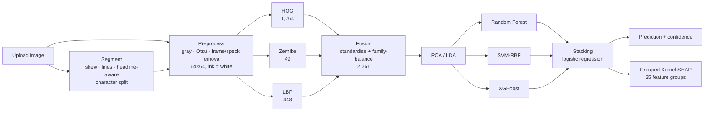

# Modi Lipi XAI

**Explainable recognition of handwritten Modi script using classical machine learning, with no deep
learning, and a measurement of how far handcrafted features carry as training data grows.**

**Headline:** 57 handwritten Modi characters, public MODI-HChar dataset, fixed held-out test set of
11,400 images: **SVM 84.5%**, stacking ensemble 81.3% at 500 training images per class, on a laptop
CPU, with a SHAP explanation for every prediction. See [Results](#results).

### Quick start

```bash
python -m venv .venv
```

```bash
.venv\Scripts\activate
```

```bash
pip install -r requirements.txt
```

```bash
python scripts/download_data.py
```

```bash
python scripts/run_preprocessing.py
```

```bash
python scripts/run_feature_extraction.py
```

```bash
python scripts/run_training.py
```

```bash
python scripts/run_evaluation.py
```

```bash
streamlit run app/app.py
```

### Architecture



Tests: `python -m pytest -q` (17 fast unit tests + a headless end-to-end app test).

## What is Modi script?

Modi (मोडी) is a cursive script that was used to write Marathi for about 700 years. It appears in
land records, court documents and administrative letters across Maharashtra. Very few people can
read it today, so millions of archived documents are effectively locked away.

## Research question

> **At what training-set size does handcrafted feature engineering stop being competitive with deep
> learning for Modi script recognition?**

None of the ten surveyed papers (2021–2024) can answer this:

- The **deep-learning papers** (CNN, VGG16, ResNet, InceptionV3, LSTM; 86–98.92%) were capped at a
  benchmark of about **90 images per class**.
- The **classical papers** (Zernike + DCT with KNN; HOG alone; wavelet + SVD with Euclidean distance;
  97.77–99.3%) used **private datasets of undisclosed size**. One covers only 27 of 46 characters.

The public MODI-HChar dataset is described by its uploader as having about 10,100 images per class
(unverified until the loader counts it), roughly two orders of magnitude more than that benchmark. That makes it the first dataset large enough to trace classical performance from the
benchmark's size upward. **The learning curve is therefore a primary contribution, not a supporting
chart.**

### What the surveyed papers' own results show

The ~90-per-class regime visibly hurt the deep models. A shallow ResNet9 (98.92%) beats ResNet50
(91.91%) and InceptionV3 (86%), an inverted ranking that only makes sense as overfitting. Another
paper reports 97.6% train vs 87.3% validation accuracy, a 10-point gap. This remains a valid
criticism of those papers. **It is not the justification for this project's choice of method,**
because this project has far more data available. The question here is empirical: how good can an
explainable, CPU-only, handcrafted pipeline get, and where does its curve flatten?

### Contributions (gaps this project targets)

1. **Three-family descriptor fusion.** HOG (stroke direction) + Zernike moments (rotation-invariant
   global shape) + LBP (local texture at stroke junctions). No surveyed paper fuses more than two
   families, and none uses LBP. An ablation measures each family alone vs fused.
2. **A stacking ensemble** (Random Forest + SVM-RBF + XGBoost) in place of the single weak classifier
   (KNN, decision tree, Euclidean distance) used by every classical paper.
3. **Explainability** with SHAP, globally and per prediction. None of the surveyed papers explains
   its predictions.
4. **Per-class error analysis**: a full confusion matrix, a table of the most-confused character
   pairs, and results broken down by category (digits vs vowels vs consonants).
5. **The data-regime question**: a learning curve at **72 / 90 / 250 / 500 / 1000 / 2000** training
   images per class for the classical ensemble **and** an untuned reference CNN, on identical splits.
   The 2000 point shows whether the curves have flattened.

### About the 72 and 90 points

The surveyed benchmark had 90 images per class *in total*. After a typical 20% test split, that is
about **72 training images per class**. The 72 point therefore **approximates** the papers' effective
training size, and the 90 point matches their total per-class count. **Only the sample size is
comparable.** The dataset, the class inventory (46 vs this dataset's classes) and the handwriting are
all different. Results at 72 are *approximately comparable* in sample size and never "on equal
footing" with the published numbers.

### Scope and limits (stated up front)

- **Deep-learning comparison = an untuned reference CNN trained on the same splits.** It is not a
  comparison against published figures from other datasets. The CNN is a plain, fixed architecture
  (three conv/BN/ReLU/pool blocks, dropout, dense head) with textbook defaults chosen before any
  results were seen. It is **deliberately not tuned**: tuning only one side would make the comparison
  meaningless in either direction. A tuned or larger network could score higher. The finding should
  be read as *plain CNN vs plain-but-careful classical pipeline*, under identical data, splits, test
  set, input images and metrics. Details: [Reference CNN baseline](#reference-cnn-baseline-not-part-of-the-pipeline).
- The CNN is a **baseline only**. It is not in the pipeline, not in `src/models.py` and not in the app.
- Published accuracies from the surveyed papers appear only in the app's literature table, for
  context, with an explicit note that they come from other (often private) datasets and are **not
  directly comparable**.

## Experimental design

- **Classes:** all classes found on disk (the uploader describes 57: 10 digits, 12 vowels,
  35 consonants). Nothing is hard-coded; see `results/metrics/dataset_summary.json`.
- **One seeded ordering per class.** Each class's files are shuffled with an RNG derived from the
  global seed (42) and a stable hash of the class label. Every subset below is a prefix of that
  ordering, so it is a genuine random sample, identical across runs and machines, and unaffected by
  other classes.
- **Fixed held-out test set:** the first 200 images of every class (see the short-class policy
  below). The same test set is used for every experiment, every curve point and both model families.
- **Learning curve:** training sets of 72 / 90 / 250 / 500 / 1000 / 2000 images per class, taken
  from the images after the test block. The sets are nested (72 ⊂ 90 ⊂ 250 ⊂ …).
- **Main experiment** (model comparison, ablation, confusion analysis, SHAP) = **the 500-per-class
  point**, so the headline numbers and the learning curve agree exactly. Cross-validation runs
  inside the training set only.
- **Per-category reporting:** every metric is also broken down into digits / vowels / consonants.
- Only the 2,200-per-class pool these experiments need (200 test + 2,000 train) is preprocessed by
  default. `--max-per-class 0` processes everything.

### Short-class policy (never fails quietly)

- **Test size is decided once per class**, from its image count *N*, so the test set never changes
  between curve points. If *N* ≥ 200 + 72 = 272, the class gets 200 test images. Otherwise its test
  set is **scaled** to ⌊0.2·N⌋ (minimum 1), matching an 80/20 split.
- **A class with fewer training images than a curve point stays in that point** with every training
  image it has. The class set is therefore identical at every point. The point is marked
  **incomplete** (hollow marker on the headline chart), and accuracy is *additionally* reported on
  the complete classes only, so any distortion is visible.
- Every short class is logged in a warning banner and recorded in `dataset_summary.json`
  (`split_plan_full_dataset` and `preprocessing.split_plan_processed_pool`) and in every curve-point
  result.
- Known boundary effect: just below 272 images, a scaled class can end up with *more* training images
  than a class just above it (e.g. 271 gives 54 test / 217 train, while 272 gives 200 test / 72 train).
  This only matters if such classes exist, so it is **measured, not assumed**. Every run reports how
  many classes have 150–400 images (`boundary_band` in the split plan). If any do, the rule switches
  to the smooth `test = min(200, max(20, int(0.2 * n)))`, which has no cliff. If none do, the rule
  stays and this note documents why.

### Compute plan for the 2000 point

RBF-SVM training scales roughly quadratically with sample count. `probability=True` adds an internal
5-fold cross-validation for Platt scaling, and the stacking ensemble's own cross-validation multiplies
that again. At about 114k training samples this could take days. Plan:

1. Time the SVM alone at 250 and 500 and extrapolate **before** attempting 1000 or 2000.
2. If infeasible, in order of preference: (a) subsample only the SVM's training data, (b) replace
   `probability=True` with `decision_function` plus a calibration wrapper, (c) drop the SVM at the
   largest points and report the ensemble as RF + XGBoost there, clearly labelled.
3. Any such change is reported as a **compute constraint** at the affected points. The ensemble's
   composition is never changed silently between points.
4. If the 2000 point is infeasible for either family, it is cut for **both** curves, never just one.

Measured CNN cost on this laptop is about 4 ms per training image per epoch on CPU, so roughly 7 min
per epoch at the 2000 point and an estimated ~6 h for the whole CNN curve.
`python scripts/run_cnn_baseline.py --estimate` re-measures this on the real data.

## Setup (Python 3.11+, tested on 3.14, CPU only)

```bash
python -m venv .venv
```

```bash
.venv\Scripts\activate
```

```bash
pip install -r requirements.txt
```

Then check that every library *actually works* on your Python (this trains a tiny model, runs SHAP,
HOG, LBP, Zernike, OpenCV and XGBoost on dummy data, and prints PASS/FAIL per library):

```bash
python scripts/check_environment.py
```

**PyTorch is a baseline dependency, not a pipeline dependency.** It is used only to train the
reference CNN (`src/baselines/`, `scripts/run_cnn_baseline.py`). The pipeline, the models and the web
app never import it. On Windows the pinned PyPI wheel is CPU-only. On Linux, install the CPU build
first to avoid a multi-GB CUDA download: `pip install torch==2.14.1 --index-url https://download.pytorch.org/whl/cpu`.

### Kaggle credentials (needed once, for the download)

The `kaggle` package (v2.x) accepts any **one** of the following. They are checked in this order:

| Method | How |
|---|---|
| New-style API token | env var `KAGGLE_API_TOKEN`, or the token text saved to `~/.kaggle/access_token` |
| Legacy API key | `~/.kaggle/kaggle.json` containing `{"username": "...", "key": "..."}`, or env vars `KAGGLE_USERNAME` + `KAGGLE_KEY` |
| OAuth | run `kaggle auth login` once (cached in `~/.kaggle/credentials.json`) |

Create a key at <https://www.kaggle.com/settings/api>. On Windows, `~` is `C:\Users\<you>`.
`KAGGLE_CONFIG_DIR` moves only `kaggle.json`. None of these files may be committed, and all of them
are in `.gitignore`.

No credentials? Download the zip in your browser from the
[dataset page](https://www.kaggle.com/datasets/msd6013/modi-hdc-historical-handwritten-modi-script)
and run `python scripts/download_data.py --from-zip "C:\path\to\archive.zip"`.

## Dataset: MODI-HDC (measured numbers)

The Kaggle bundle is **~10 GB** and holds two datasets:

- **MODI-HChar**: isolated handwritten characters in `category/class/image` folders.
- **MODI-HHDoc**: full handwritten document pages. Only a 20-page sample is extracted, for testing
  segmentation.

What the loader actually counted on disk (`results/metrics/dataset_summary.json`):

| | Measured | Uploader's claim | Surveyed papers' benchmark |
|---|---|---|---|
| Classes | **57** (10 digits, 12 vowels, 35 consonants) | 57 | 46 |
| Images | **575,912** | 575,920 (8 fewer found) | 46 × 90 = 4,140 |
| Images per class | **10,098 – 10,110** (max/min = 1.001) | ~10,100 | 90 |
| Image format | 170×170 RGB JPEG | | |
| Files skipped | 20 (15 hidden/system, 5 `.psd`) | | |

Note the class-count inconsistency: the papers say 46, this dataset has 57, and its 12 vowels +
35 consonants make 47 letters. The 35 consonants include the conjuncts क्ष, ज्ञ, त्र, श्र and omit
ङ, ञ, ष. `results/figures/class_reference_sheet.png` shows three real examples of every class.
**The Devanagari shown in the app is inferred from the romanised folder names and is not yet
verified.** The ten dental/retroflex classes (`ta`, `th`, `tha`, `thh`, `thha`, `d`, `dh`, `dha`, `n`,
`nn`) cannot be mapped from their names, so no Devanagari is shown for them (see `src/labels.json`).

## Preprocessing (stage 1)

- **Polarity:** every processed image is uint8 with **ink = 255 (white) on background = 0 (black)**.
  Ink is the minority side of the Otsu threshold. The image border is used only as a tie-break,
  because many scans carry a faint frame around the edge that fooled a border-first rule.
- **Blank images are rejected:** 16 images in the pool contain no glyph at all.
- **Scan-frame removal:** about **10%** of dataset images carry a fragment of the scanning frame
  along an edge. Left in, it shrinks and off-centres the glyph. The outer 2% is blanked, and
  elongated components lying entirely within 7% of an edge are removed. Headlines are attached to
  the glyph, so they survive.
- Grayscale → median blur → blank check → Otsu → frame removal → speck removal (dots and matras
  survive) → crop to ink → pad to square → area-resize to 64×64 → re-binarise.
- **Deskew is off by default.** On an isolated character, moment-based slant cannot be told apart
  from the glyph's own diagonal strokes, and in testing it sheared upright glyphs. Page and line skew
  are corrected in segmentation instead.
- **Known residual:** a small number of images keep a thin frame fragment slightly *inside* the edge
  band (visible on the class reference sheet). That is an easy next improvement.
- The default pool is **2,230 images per class** (200 test + 2,000 largest training size + 30
  reserve): 127,110 selected, **127,087 processed**, 23 rejected as blank or inkless.

## Features (stage 3)

| Family | What it captures | Dimensions | Extraction time |
|---|---|---|---|
| HOG (8×8 cells, 2×2 blocks, 9 orientations, light blur first) | stroke direction and layout | 1,764 | 0.47 ms / image |
| Zernike moments (degree 12, disc = whole image) | rotation-invariant global shape | 49 | 0.36 ms / image |
| LBP (uniform, two scales: P=8/R=1 and P=16/R=2, 4×4 grid) | stroke ends, corners, junctions | 448 | 0.59 ms / image |
| **Fused** | all three | **2,261** | |

Measured on a real glyph, a 10° rotation changes the Zernike vector by **3.5%** and the HOG vector
by **79%**. That complementarity is the reason for fusing them.

**Family-balanced fusion (novelty).** After standardising, each family is scaled by 1/√(its size),
so HOG's 1,764 values cannot outvote Zernike's 49 in PCA or in the RBF kernel. The ablation compares
this with plain concatenation.

## Models (stage 5) and compute constraints

Every pipeline is: standardise → family-balance → PCA (or LDA) → model. PCA keeps the fewest
components reaching 95% of variance, capped at 300. In practice it hits the cap, at 87% variance.

- **Random Forest** (400 trees), **SVM-RBF** (C = 10), **XGBoost**, and a **StackingClassifier**
  whose meta-learner is a logistic regression on the base models' out-of-fold outputs.
- The base models inside the fitted stack are trained on the full training set, and they are also
  the "each model on its own" results. Nothing is trained twice.

**Compute constraints (documented, not hidden):**

- The SVM runs **without `probability=True`**, which would add an internal 5-fold Platt-scaling
  cross-validation to every fit. The stack feeds it the SVM's *decision scores*, and the logistic
  regression produces the calibrated probabilities.
- **XGBoost was the bottleneck,** not the SVM. With 57 classes it builds 57 trees per round, and the
  original 300 rounds × depth 5 took 3–4 min at the smallest curve point. It now uses 200 rounds ×
  depth 3 with 32 histogram bins, which matched the original's accuracy at 72 images per class
  (65.2% vs 65.0%) about 4× faster. Multi-output trees were tried and were slower.
- Stacking uses **3 internal folds** (not 5), and base models train one after another: running them in
  parallel oversubscribed the CPU and stalled.
- Cross-validation of the full pipeline uses **3 folds**, because each fold retrains the whole stack.
- **The ensemble's composition never changes between curve points.**

## Segmentation (stage 2)

Lines come from the horizontal projection profile, after a projection-profile skew search
(±12°). Characters come from blank columns of the full image, including the headline, so a character
whose parts touch only through its own headline stays whole. Over-wide segments are split after
removing the headline (shirorekha) *inside* that segment, or else at the deepest column valley.
Fragments narrower or lighter than a typical character (detached strokes, dots, headline tails)
are merged into the nearer neighbour, but never into an over-wide box. Every box carries flags
(`wide`, `narrow`, `tall`, `connected`) and a confidence, and the app explains them in plain
language.

Tested on the bundled samples, which are composed from **test-split** glyphs with known answers:
**5/5, 8/8 and 6/6 characters found.** On a crop of a real manuscript page, the writing is
continuous cursive and the result is correctly reported as unreliable. **Segmenting real
connected Modi writing is not solved here; the app says so instead of hiding it.**

## Explainability (stage 7)

Raw SHAP over 2,261 features would be unreadable and slow, so the features are grouped into **35
meaningful units**: HOG and LBP evidence in each cell of a 4×4 image grid (16 + 16), and Zernike
coarse / medium / fine shape (3). **Kernel SHAP** then explains the *stacking ensemble's* probability
for a class against an "average character" baseline (the mean training feature vector). Two checks
run on every global computation:

- **Additivity:** the baseline plus the contributions must equal the model output.
- **Faithfulness (deletion test):** hiding the top-ranked groups must lower the probability more
  than hiding random groups.

Only the baseline vector is cached (`results/shap/baseline.npy`); the explainer is built around the already-loaded model in milliseconds.

## Web app

```bash
streamlit run app/app.py
```

- **Recognise:** drag-and-drop upload or four bundled samples. It shows numbered boxes coloured
  green, amber or red by confidence, a strip of cropped characters with confidence bars, and the
  assembled reading (romanised, plus Devanagari where the mapping is unambiguous). A detail panel
  per character has the enlarged crop, the 64×64 model input, top-3 probabilities, each base model's
  vote, SHAP evidence for the prediction and for the runner-up, and heat overlays showing *where*
  on the glyph the evidence came from. Results download as CSV or JSON.
- **Pipeline Dashboard:** the clickable stage flow shows the actual intermediate output for the
  current image, from upload through preprocessing, segmentation, HOG, Zernike, LBP, fusion,
  PCA/LDA, the ensemble and the prediction to SHAP. It also has the measured dataset summary, a
  model comparison with cross-validation, the learning curve (classical vs CNN), the ablation, an
  interactive confusion matrix, the most-confused pairs, global SHAP, and a literature table with
  an explicit not-comparable warning.

## Pipeline

| Stage | Script |
|---|---|
| Environment check | `python scripts/check_environment.py` |
| Download data | `python scripts/download_data.py` (`--from-zip`, `--force`, `--delete-zip`) |
| Preprocess + dataset stats | `python scripts/run_preprocessing.py` (`--max-per-class 0` = all, `--summary-only`, `--force`) |
| Feature extraction | `python scripts/run_feature_extraction.py` (`--force`, `--only hog`) |
| Training: main, PCA vs LDA, ablation, CV, learning curve | `python scripts/run_training.py` (`--only ...`, `--sizes ...`, resumes) |
| Evaluation + figures + SHAP | `python scripts/run_evaluation.py` (`--skip-shap`, `--force-shap`) |
| App samples + class reference sheet | `python scripts/make_sample_images.py` |
| *Reference CNN baseline* | `python scripts/run_cnn_baseline.py` (`--estimate`, `--sizes`, `--force`, `--plot-only`) |
| Web app | `streamlit run app/app.py` |

All tunable parameters live in [`src/config.py`](src/config.py). The random seed is fixed at 42, so
results are reproducible.

## Results

All numbers are on the **fixed test set: 200 images per class × 57 classes = 11,400 images**, never
used for training or tuning. Main experiment: fused HOG + Zernike + LBP features, family-balanced,
PCA to 300 dimensions (85.5% of variance), **500 training images per class** (28,500 images).

| Model | Test accuracy | Macro-F1 | Digits | Vowels | Consonants | Train time | Size |
|---|---|---|---|---|---|---|---|
| Random Forest | 74.57% | 0.743 | 82.0% | 81.8% | 70.0% | 2 min | 225 MB |
| **SVM (RBF)** | **84.50%** | **0.845** | **91.2%** | **89.1%** | **81.0%** | 3 min | 37 MB |
| XGBoost | 78.22% | 0.783 | 85.3% | 83.0% | 74.6% | 68 min* | 3 MB |
| Stacking ensemble | 81.33% | 0.813 | 88.3% | 85.3% | 78.0% | 100 min* | 268 MB |

\* Measured on a laptop CPU shared with another heavy job, so absolute times are inflated.

### What the results say (stated plainly)

- **The SVM alone is the best classical model, beating the stacking ensemble by 3.2 points.** The
  same thing happened at 72 images per class (SVM 75.3% vs stack 69.8%). Likely cause: with 3
  internal folds, the meta-learner learns from base models trained on two-thirds of the data and
  from much weaker RF/XGBoost outputs. **This contradicts the assumption that stacking helps,** and
  is reported as a finding, not hidden. The app still uses the stack because it gives calibrated
  probabilities, and every report also shows the best single model.
- **Digits are easiest and consonants hardest,** for every model: 91% vs 81% for the SVM.
- **Most errors are look-alike confusions:** 1,772 of the 2,128 errors (83%) stay inside the same
  category. The most confused pairs are `i`↔`ii` (91 test images, 22.8% of the pair), `h`↔`thha` (78),
  `five`↔`six`, `ja`↔`n` and `p`↔`thha` (53 each). See `results/figures/most_confused_pairs.png`.
- Hardest classes (F1): `thha` 47%, `h` 53%, `p` 57%, `th` 66%, `b` 68%. Easiest: `one` 94%, `eight`
  94%, `zero` 93%.
- **Explainability (global SHAP, 171 test images, stacking ensemble):** share of total importance
  is HOG 43.6%, **LBP 39.4%**, Zernike 17.0%. LBP, the descriptor none of the surveyed papers uses,
  carries about two-fifths of the decisions. Read the family shares with care: Zernike has 3 groups
  against 16 each for HOG and LBP, and **per group the most influential feature in the whole model
  is Zernike's fine shape detail (orders 9+).** The evidence sits in the centre of the glyph, while
  the image edges contribute almost nothing.
- **The explanations are faithful and exact:** hiding the 3 groups SHAP ranks highest lowers the
  predicted probability by 0.447 on average, versus 0.084 for 3 random groups (5.3×). The additivity
  error is 0.0000.
- Learning curve, ablation, PCA vs LDA and cross-validation results are written to
  `results/metrics/` as each experiment finishes, and the dashboard reads them live.

### Comparison with the literature (context only, not a like-for-like comparison)

The surveyed deep-learning papers report 86–98.92% on a **46-class, 90-images-per-class** benchmark,
and the classical papers report 97.77–99.3% on **private** datasets of undisclosed size. This project
reports **84.5% (SVM) / 81.3% (stack)** on **57 classes of a public dataset**, with a fixed held-out
test set of 11,400 images and no tuning on that test set. The numbers are **not comparable**: they
differ in dataset, class count, split and metric (several papers report validation or even training
accuracy). They are placed side by side in the app only with that warning.

## Reference CNN baseline (not part of the pipeline)

This exists only to answer the research question. It lives in `src/baselines/` and
`scripts/run_cnn_baseline.py`, apart from the pipeline, and the app never uses it.

- **Fixed and untuned.** `conv3x3(32)-BN-ReLU-pool → conv3x3(64)-BN-ReLU-pool → conv3x3(128)-BN-ReLU-pool
  → dropout(0.5) → dense(256)-ReLU → dropout(0.5) → dense(classes)`, about 2.2M parameters. Adam
  (lr 1e-3), batch 128, at most 40 epochs, early stopping with patience 6. These are textbook defaults
  set in `config.CNN_BASELINE` before any results were seen. No architecture or hyperparameter search
  is done, so no reviewer can say the baseline was handicapped (or flattered) to suit the classical
  side.
- **Identical conditions.** It uses the same seeded splits, the same fixed 200-per-class test set,
  the same preprocessed 64×64 input images, and the same scoring function
  (`learning_curve.score_predictions`). Neither side gets augmentation.
- **No hidden data handicap.** Early stopping uses a 10% validation slice taken from the *training*
  set only. The CNN is then **refit on 100% of the training set** for the selected number of epochs,
  so it sees exactly the images the classical models see. **Why the refit matters:** without it, the
  CNN would train on about 10% fewer images than the classical models at every curve point. That
  would handicap the CNN and make the comparison **invalid in the classical pipeline's favour**.
  The validation phase only chooses the epoch count. The refit costs extra training time, which is
  included in the reported cost. Do not remove it (`config.CNN_BASELINE.refit_on_full_train` must
  stay `True` for any reported result).
- **Reproducible.** It is seeded, with `torch.use_deterministic_algorithms(True)`, on CPU.
- **Reported cost.** Wall-clock training time, parameter count, serialised model size and inference
  time per image are reported at every point, because compute cost is part of the classical argument.
- **Headline figure:** `results/figures/learning_curve_classical_vs_cnn.png` plots both accuracy
  curves against training images per class, shades the crossover region if there is one, marks
  incomplete points with hollow markers, and shows training time alongside.

## Repository layout

```
docs/       literature survey, synopsis, reference papers, final report
data/       raw / processed images and cached features (gitignored)
src/        pipeline code (preprocess, segmentation, features, reduce, models, evaluate, explain, predict)
            learning_curve.py: shared scoring, curve results, headline figure
src/baselines/  REFERENCE CNN ONLY: never imported by the pipeline or the app
scripts/    standalone entry points, one per stage (+ check_environment.py, run_cnn_baseline.py)
notebooks/  exploration, feature analysis, results analysis
models/     trained models (gitignored)
results/    figures, metrics JSON, SHAP outputs
app/        Streamlit web app
```

## References

The literature survey (`docs/01_literature_survey/Literature_Survey_30_Papers.xlsx`) covers the 30 open-access papers below; PDFs are in `docs/03_reference_papers/`. Author and venue metadata come from OpenAlex/arXiv and should be checked against each PDF before submission. Several important paywalled papers (Zernike + DCT 2023, HOG-based 2024, wavelet + SVD 2020) are listed separately in `docs/03_reference_papers/INDEX.md`.

1. Rahul A. Mahajan (2026). *A Framework for Modi-Lipi Script Based On CAPTCHA*. International Journal on Advanced Electrical and Computer Engineering. https://doi.org/10.65521/ijaece.v15i1s.1383
2. Anshika Jain, Maya Ingle (2026). *A Novel Model For Transliterating MODI To Devanagari Script*. International Journal of Advances in Signal and Image Sciences. https://doi.org/10.29284/s06egq94
3. Mr. Anup Arun Govande (2026). *AI-Driven Model for Converting Modi Lipi Documents into the English Language*. International Journal of Research and Innovation in Applied Science. https://doi.org/10.51584/ijrias.2026.11030031
4. Mrunali Manohar Bhong, Prof. Nanda Kulkarni (2025). *Handwritten Modi Script Character Recognition Using CNN and VGG16 Algorithms*. International Journal of Advanced Research in Science Communication and Technology. https://doi.org/10.48175/ijarsct-25317
5. Harshal Kausadikar, Tanvi Kale, Onkar Susladkar et al. (2025). *Historic Scripts to Modern Vision: A Novel Dataset and A VLM Framework for Transliteration of Modi Script to Devanagari*. arXiv preprint (2503.13060). https://doi.org/10.48550/arXiv.2503.13060
6. Shweta Kolte, Dr. Brijendra Gupta (2025). *Modi Script Character Recognition Using Convolutional Neural Networks and Attention-Based CNN Architecture*. International Journal of Advanced Research in Science Communication and Technology. https://doi.org/10.48175/ijarsct-25309
7. Chaitali Chandankhede (2025). *Modi Script Handwritten Character Classification using Drop-out Induced Incremental Learning Approach*. Journal of Information Systems Engineering & Management. https://doi.org/10.52783/jisem.v10i10s.1403
8. Mrunali Manohar Bhong, Brijendra Parasnath Gupta (2025). *Review on MODI Script Character Recognition Using Deep Learning Techniques*. International Journal of Advanced Research in Science Communication and Technology. https://doi.org/10.48175/ijarsct-25318
9. Shilpa K. Aher, Govind Kharat, Prof. N. B. Bankhele (2024). *Advancements in Modi Script Character Recognition: A Comprehensive Survey*. International Journal of Advanced Research in Science Communication and Technology. https://doi.org/10.48175/ijarsct-18713
10. Shweta Kolte, Dr. Brijendra Gupta (2024). *Bridging Heritage and Technology: A Review of Modi Script Character Recognition*. International Journal of Advanced Research in Science Communication and Technology. https://doi.org/10.48175/ijarsct-22266
11. Ravindra Sonavane, Pandharinath Ghonge, Sandip Umajirao Patil et al. (2024). *Exploring ResNet101, InceptionV3, and Xception for Modi Script Character Classification*. International Journal of Intelligent Systems and Applications in Engineering. https://ijisae.org/index.php/IJISAE/article/download/4841/3529
12. Solley Joseph, Jossy Paul George (2024). *Machine Transliteration of Handwritten MODI Script to Devanagari using Deep Neural Networks*. International Journal of Computing. https://doi.org/10.47839/ijc.23.4.3540
13. Teja Kundaikar, Swapnil Fadte, Ramdas Karmali et al. (2024). *Modi Document Transcription to Devanagari*. Ingénierie des systèmes d information. https://doi.org/10.18280/isi.290311
14. Sakshi  Mandke, Varsha Pimprale, Prakash Date (2024). *Offline MODI script character recognition using deep learning techniques*. Library Progress (International). https://bpasjournals.com/library-science/index.php/journal/article/download/829/2327
15. Haazique Sayyed, Vaibhavi Pathak, Pranav Wagholikar et al. (2024). *Preserving Cultural Heritage: Mapping of Handwritten Modi Script to Devanagari Characters*. International Journal of Engineering Trends and Technology. https://doi.org/10.14445/22315381/ijett-v72i8p107
16. More Meghana Laxman, Prof. S. G. Joshi (2023). *A Review of Advances and Challenges in Modi Character Recognition*. International Journal of Advanced Research in Science Communication and Technology. https://doi.org/10.48175/ijarsct-14210
17. Kanchan Varpe, Sakhare Sachin (2023). *Analyzing Different Techniques to Generate Image Datasets for MODI Script Handwritten Character Recognition*. International Journal of Intelligent Systems and Applications in Engineering. https://ijisae.org/index.php/IJISAE/article/download/4262/2910
18. Panchfula Lohkare, Rutuja Pol, Snehal Shnde et al. (2023). *Classification of Ancient Modi Script Characters using Convolutional Neural Network*. International Journal of Advanced Research in Science Communication and Technology. https://doi.org/10.48175/ijarsct-10455
19. Unknown author (2023). *MODI Lipi Handwritten Character Recognition Using Convolutional Neural Networks (CNN)*. International Research Journal of Modernization in Engineering Technology and Science. https://doi.org/10.56726/irjmets40141
20. Kanchan Varpe, Sachin Rambhau Sakhare (2023). *Review of Character Recognition Techniques for MODI Script*. Indian Journal of Science and Technology. https://doi.org/10.17485/ijst/v16i26.485
21. Maitreyi Ekbote, Aishwary Jadhav, Dayanand D. Ambawade (2022). *Implementing a Hybrid Deep Learning Approach to Achieve Classic Handwritten Alphanumeric MODI Recognition*. International Journal of Engineering and Advanced Technology. https://doi.org/10.35940/ijeat.a3846.1012122
22. Unknown author (2022). *REVIEW ON MODI HANDWRITTEN CHARACTERS RECOGNITION*. International Research Journal of Modernization in Engineering Technology and Science. https://doi.org/10.56726/irjmets31334
23. Kishor Patil, Neha Gupta, M Damodar et al. (2022). *Towards Modi Script Preservation: Tools for Digitization*. Computer Science and Information Technology. https://doi.org/10.5121/csit.2022.121305
24. Bhumika Solanki, Maya Ingle (2019). *An Experimental Exploration of Segmentation Techniques for Modi Script*. International Journal of Computer Applications. https://doi.org/10.5120/ijca2019918602
25. Chatterjee Shekhar (2018). *Designing a New Digital Font for Modi-Script*. Ergonomics International Journal. https://doi.org/10.23880/eoij-16000150
26. Sidra Anam, Saurabh Gupta (2015). *An Approach for Recognizing Modi Lipi using Ostu's Binarization Algorithm and Kohenen Neural Network*. International Journal of Computer Applications. https://doi.org/10.5120/19511-1128
27. Kulkarni SadanandA., Borde Prashant L., Manza Ramesh R. et al. (2015). *Review on Recent Advances in Automatic Handwritten MODI Script Recognition*. International Journal of Computer Applications. https://doi.org/10.5120/20257-2636
28. Sadanand A. Kulkarni, Prashant L. Borde, Ramesh R. Manza et al. (2014). *Recognition of Handwritten MODI Numerals using Hu and Zernike features*. arXiv preprint (1404.1151). https://doi.org/10.48550/arXiv.1404.1151
29. D. N. Besekar, Rakesh Jagdish Ramteke (2013). *Study for Theoretical Analysis of Handwritten MODI Script A Recognition Perspective*. International Journal of Computer Applications. https://doi.org/10.5120/10618-5340
30. Anshuman Pandey (2011). *Proposal to Encode the Modi Script in ISO/IEC 10646*. Unicode Technical Committee document L2/11-212R2 (N4034). https://www.unicode.org/L2/L2011/11212r2-n4034-modi.pdf
